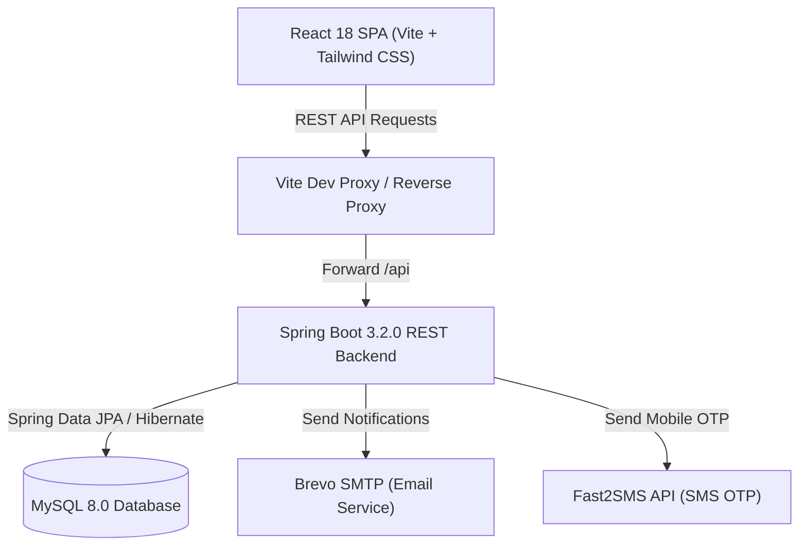

# 🏍️ Rydo — Peer-to-Peer Hourly Bike Sharing Platform

<p align="center">
  
  
  
  
  
  
  
  
</p>

---

## 📖 Overview

**Rydo** is India's hourly peer-to-peer (P2P) two-wheeler rental marketplace designed to solve urban mobility bottlenecks and unlock passive income for bike owners. 

Whether commuting through rush hour, taking a weekend road trip, or running errands, users can rent verified motorcycles and scooters by the hour directly from trusted local owners. Rydo incorporates end-to-end security, dynamic surge pricing, digital vehicle condition inspections, and community gamification.

---

## ✨ Key Features

### 🛵 1. Peer-to-Peer Bike Listing & Discovery
- **Multi-Category Fleet**: Supports Cruisers, Scooters, Sports Bikes, and Daily Commuters (e.g., Royal Enfield Classic 350, Honda Activa 6G, Bajaj Dominar 400).
- **Interactive Geolocation**: Built-in coordinate and address picker with distance calculation.
- **Owner Controls**: Custom hourly pricing, dynamic pricing toggle, automatic approval flags, and detailed vehicle specs (year, mileage, fuel type, number plate).

### ⏱️ 2. Hourly Availability & Smart Booking Engine
- **Custom Availability Slots**: Owners define exact booking slots for maximum schedule flexibility.
- **Live Booking Workflow**: Renters select dates and hours with immediate price calculation, instant slot reservation, and real-time status transitions (`PENDING`, `CONFIRMED`, `CANCELLED`, `COMPLETED`).
- **Owner Approvals & Cancellation Reasons**: Full visibility for owners to review rental requests before approval or provide structured cancellation feedback.

### 📈 3. Dynamic Surge Pricing Engine
- **Peak Hour Surge**: Automatically applies a 20% surge during peak traffic intervals (8:00–10:00 AM, 5:00–8:00 PM).
- **Weekend Adjustment**: 15% weekend uplift to reflect leisure travel demand.
- **Off-Peak Discounts**: 15% incentive discounts for renters during low-demand hours.
- **Safety Cap**: Guardrails prevent surge multiplier from exceeding 1.4x.

### 🛡️ 4. RideGuard Safety Inspection & Verification
- **Pre-Ride & Post-Ride Vehicle Check**: Captures digital walkaround inspection records before and after each rental.
- **Condition Analysis**: Audits scratches, dents, tyre wear, and rear-view mirrors.
- **Safety Scoring**: Computes algorithmic safety scores (up to 100) to protect owners and riders against disputes.

### 🪙 5. EarnCoins Rewards & Trust Score System
- **Gamified Community Rewards**:
  - Renters earn 5 EarnCoins per rental hour.
  - Owners earn 1 EarnCoin for every ₹10 earned on bookings.
  - Coins can be redeemed for listing boosts and rental discounts.
- **Reputation & Trust Score**: Dynamic 100-point trust score system based on ride completion history, user reviews, and vehicle return condition.

### 🔐 6. Identity Verification & Multi-Channel Alerts
- **OTP Verification**: Indian SMS OTP verification powered by Fast2SMS.
- **Email Notifications**: Transactional booking confirmations and status updates via Brevo (Sendinblue) SMTP.
- **Government ID Verification**: Aadhaar and Driving License verification badges.

### 👑 7. Comprehensive Admin Management Portal
- **Platform Analytics**: Real-time metric cards for total users, active listings, gross revenue, and pending verifications.
- **Listing Governance**: One-click approval and rejection workflows for newly posted bikes.
- **User Moderation**: Instant ban/unban capabilities to maintain community standards.

---

## 🏗️ Architecture & Technology Stack



### **Backend**
- **Framework**: Spring Boot 3.2.0
- **Language**: Java 17
- **Database Access**: Spring Data JPA, Hibernate ORM
- **Database**: MySQL 8.0+
- **Communications**: Spring Mail (Brevo SMTP), Fast2SMS API
- **Utilities**: Project Lombok, Jakarta Validation, Spring Boot DevTools

### **Frontend**
- **Framework**: React 18
- **Build Tool**: Vite 5
- **Styling**: Tailwind CSS, PostCSS, Autoprefixer
- **Icons**: Lucide React
- **Routing**: React Router DOM v6
- **HTTP Client**: Axios
- **Date Handling**: Date-fns

---

## 📁 Repository Structure

```
Rydo_FinalProject/
├── .gitignore                          # Clean gitignore for Java, Node, OS files
├── README.md                           # Documentation & setup guide
├── rydo-backend/                       # Spring Boot REST API
│   ├── pom.xml                         # Maven dependencies & plugins
│   └── src/
│       └── main/
│           ├── java/com/rydo/
│           │   ├── RydoApplication.java# Spring Boot main class
│           │   ├── config/             # DataInitializer & demo seeders
│           │   ├── controller/         # REST Controllers (Auth, Bike, Booking, Admin, etc.)
│           │   ├── dto/                # Request & response data transfer objects
│           │   ├── entity/             # JPA Entities (User, Bike, Booking, Review, etc.)
│           │   ├── repository/         # Spring Data JPA repositories
│           │   └── service/            # Core business logic & pricing algorithms
│           └── resources/
│               └── application.properties # Spring configuration & environment mappings
└── rydo-frontend/                      # React SPA
    ├── index.html                      # Single page entry point
    ├── package.json                    # Frontend dependencies & scripts
    ├── postcss.config.js               # PostCSS configuration
    ├── tailwind.config.js              # Tailwind styling presets
    ├── vite.config.js                  # Vite server & API proxy config
    ├── public/                         # Public assets & bike images
    └── src/
        ├── App.jsx                     # Route definitions & app tree
        ├── main.jsx                    # React DOM root mounting
        ├── components/                 # Modals, Navbar, LocationPicker, OTP components
        ├── context/                    # AuthContext & user session state
        ├── pages/                      # Landing, Search, Details, Dashboards, Admin
        └── services/                   # Axios API service clients
```

---

## 🚀 Getting Started

Follow these instructions to run the entire Rydo platform locally.

### 📋 Prerequisites
- **Java**: JDK 17 or higher
- **Maven**: 3.8+ (or use embedded wrapper)
- **Node.js**: v18.0.0 or higher
- **npm**: 9.0+
- **MySQL**: 8.0+ running on `localhost:3306`

---

### 🗄️ 1. Database Setup

1. Open your MySQL client (MySQL Workbench, pgAdmin / DBeaver, or CLI):
   ```sql
   CREATE DATABASE IF NOT EXISTS rydodb CHARACTER SET utf8mb4 COLLATE utf8mb4_unicode_ci;
   ```
2. By default, Spring Boot will automatically create and update the table schemas via `spring.jpa.hibernate.ddl-auto=update`.

---

### ⚙️ 2. Backend Configuration & Startup

1. Navigate to the backend directory:
   ```bash
   cd rydo-backend
   ```
2. *(Optional)* Set environment variables or configure `src/main/resources/application.properties`:
   ```properties
   spring.datasource.url=jdbc:mysql://localhost:3306/rydodb?createDatabaseIfNotExist=true&useSSL=false&serverTimezone=UTC&allowPublicKeyRetrieval=true
   spring.datasource.username=root
   spring.datasource.password=your_mysql_password

   # Brevo Email SMTP credentials
   BREVO_MAIL_USERNAME=your_email@example.com
   BREVO_MAIL_PASSWORD=your_brevo_smtp_key

   # Fast2SMS API key
   FAST2SMS_API_KEY=your_fast2sms_api_key
   ```
3. Build and launch the Spring Boot application:
   ```bash
   mvn clean spring-boot:run
   ```
4. The backend will boot on `http://localhost:8080`.

---

### 💻 3. Frontend Setup & Startup

1. Open a new terminal tab and navigate to the frontend directory:
   ```bash
   cd rydo-frontend
   ```
2. Install dependencies:
   ```bash
   npm install
   ```
3. Start the Vite development server:
   ```bash
   npm run dev
   ```
4. Open your browser and navigate to:
   ```
   http://localhost:5173
   ```

---

## 🔑 Demo Accounts

The database comes with seed accounts ready for testing:

| Role | Email | Password | Details |
| :--- | :--- | :--- | :--- |
| **Admin** | `admin@rydo.com` | `admin123` | Platform oversight, bike approvals, bans |
| **Bike Owner** | `rahul@gmail.com` | `pass123` | Royal Enfield & Activa owner |
| **Bike Owner** | `priya@gmail.com` | `pass123` | Dominar 400 & Apache owner |
| **Renter / User** | `amit@gmail.com` | `pass123` | Standard rider account |

> **Note:** Demo seed data can also be triggered or refreshed via the `/api/admin/init-data` endpoint.

---

## 📡 REST API Reference

### 🔐 Authentication (`/api/auth`)
| Method | Endpoint | Description |
| :--- | :--- | :--- |
| `POST` | `/api/auth/register` | Register a new user (`USER`, `OWNER`) |
| `POST` | `/api/auth/login` | Authenticate and obtain user profile |
| `GET` | `/api/auth/profile/{userId}` | Retrieve profile details, trust score, coins |

### 🏍️ Bikes (`/api/bikes`)
| Method | Endpoint | Description |
| :--- | :--- | :--- |
| `GET` | `/api/bikes` | Filter bikes by category, location, min/max price |
| `GET` | `/api/bikes/featured` | Fetch top-rated featured listings |
| `GET` | `/api/bikes/{id}` | Get detailed bike information & images |
| `POST` | `/api/bikes` | Create a new bike listing (`OWNER`) |
| `PUT` | `/api/bikes/{id}` | Update listing information |
| `DELETE` | `/api/bikes/{id}` | Remove a bike listing |
| `GET` | `/api/bikes/owner/{ownerId}` | Fetch all bikes owned by a specific user |

### 📅 Availability (`/api/availability`)
| Method | Endpoint | Description |
| :--- | :--- | :--- |
| `POST` | `/api/availability/slots` | Add new availability time slot |
| `GET` | `/api/availability/bike/{bikeId}` | Get available slots for a bike |
| `DELETE` | `/api/availability/slots/{slotId}`| Remove an availability slot |

### 📝 Bookings (`/api/bookings`)
| Method | Endpoint | Description |
| :--- | :--- | :--- |
| `POST` | `/api/bookings` | Create a booking with calculated pricing |
| `GET` | `/api/bookings/{id}` | Get booking details |
| `GET` | `/api/bookings/renter/{renterId}` | Retrieve rental history for rider |
| `GET` | `/api/bookings/owner/{ownerId}` | Retrieve bookings for owner's bikes |
| `PUT` | `/api/bookings/{id}/confirm` | Owner confirms rental |
| `PUT` | `/api/bookings/{id}/cancel` | Cancel booking with reason |
| `PUT` | `/api/bookings/{id}/complete` | Complete ride & award EarnCoins |

### 🛡️ Safety & Reviews (`/api/reviews`, `/api/safety`)
| Method | Endpoint | Description |
| :--- | :--- | :--- |
| `POST` | `/api/reviews` | Submit star rating and review |
| `GET` | `/api/reviews/bike/{bikeId}` | Fetch reviews for a specific bike |
| `POST` | `/api/safety/check` | Run RideGuard pre/post-ride safety audit |

### 👑 Admin Governance (`/api/admin`)
| Method | Endpoint | Description |
| :--- | :--- | :--- |
| `GET` | `/api/admin/analytics` | Summary stats (Users, listings, revenue) |
| `GET` | `/api/admin/bikes/pending` | Retrieve bikes awaiting approval |
| `PUT` | `/api/admin/bikes/{id}/approve` | Approve a bike listing |
| `PUT` | `/api/admin/bikes/{id}/reject` | Reject a bike listing |
| `PUT` | `/api/admin/users/{id}/ban` | Toggle user ban/active status |

---

## 🗺️ Roadmap & Upcoming Features

- [ ] **Real-time Telematics**: IoT GPS tracker integration for live route telemetry and speed alerts.
- [ ] **Smart Lock Integration**: Bluetooth/Keyless digital unlocking via the Rydo mobile app.
- [ ] **UPI Auto-Pay**: Seamless digital security deposit authorization and instant refund release.
- [ ] **Native Mobile Application**: Cross-platform Flutter / React Native build for Android and iOS.

---

## 📄 License

This project is licensed under the [MIT License](LICENSE).

---

## 👨‍💻 Author

Developed with ❤️ by **[Ayyapparaja](https://github.com/ayyapparaja227-arch)**.
For inquiries, feedback, or collaborations, feel free to open an issue or pull request!
